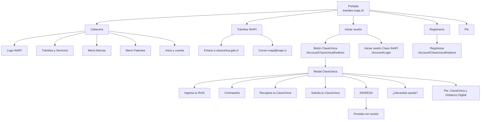
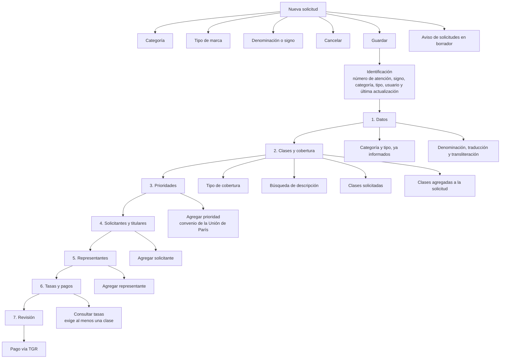
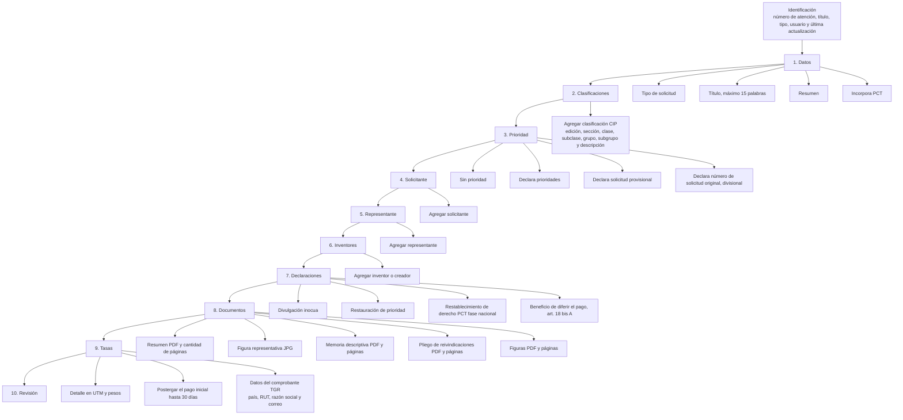
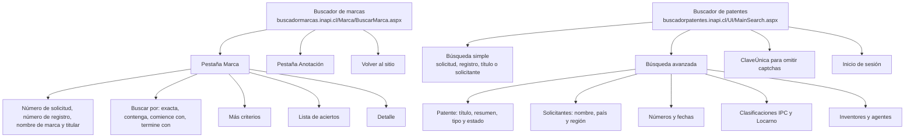

# Mapa de navegación — Sitio de trámites original de INAPI

Origen: [tramites.inapi.cl](https://tramites.inapi.cl/) y las pantallas capturadas el 15 de octubre de 2026. Las rutas del menú salen del HTML público del portal. Las pantallas internas salen de las capturas con sesión iniciada.

El portal de trámites es distinto del sitio informativo `www.inapi.cl`. El buscador de marcas y el buscador de patentes abren en otros dominios. El pie del portal vuelve al sitio informativo.

## 1. Portada sin sesión

El pie repite Dónde estamos, Conversemos y Accesos. Contacto, redes, atajos, visualizadores, glosario, mapa del sitio, uso de contenidos y accesibilidad apuntan a `www.inapi.cl`. La política de privacidad abre un PDF de INAPI.

## 2. Portada con sesión

Con sesión, la cabecera muestra el nombre de la persona junto a Marcas y Patentes. El cuerpo ofrece accesos directos en dos columnas.

```mermaid
flowchart TB
  home["Portada con sesión<br/>tramites.inapi.cl/"]

  home --> nMar["Mis notificaciones marcas<br/>/Notificaciones"]
  home --> nPat["Mis notificaciones patentes<br/>/NotificacionesPatentes"]
  home --> exp["Ver expediente digital<br/>/Trademark/TrademarkFile"]
  home --> bPat["Buscar patentes y diseño<br/>buscadorpatentes.inapi.cl"]
  home --> bMar["Buscar marcas<br/>buscadormarcas.inapi.cl"]
  home --> sPat["Solicitar patente<br/>IndexUtilityModelOrPatent"]
  home --> sMar["Solicitar marca<br/>IndexTrademark"]
  home --> sDis["Solicitar diseño<br/>IndexDesignOrIndustrialDrawing"]
  home --> gMar["Solicitudes guardadas marcas"]
  home --> gPat["Solicitudes guardadas patentes"]
  home --> eMar["Presentar escrito de marca"]
  home --> ePat["Presentar escrito de patente"]
  home --> cMar["Solicitar certificado de marca"]
  home --> cPat["Solicitar certificado de patente"]
```

## 3. Menú Marcas

```mermaid
flowchart TB
  marcas["Menú Marcas"]

  marcas --> mi["Mi INAPI"]
  marcas --> tram["Tramitación"]
  marcas --> pagos["Pagos"]
  marcas --> serv["Servicios"]

  mi --> mi1["Notificaciones electrónicas<br/>/Notificaciones"]
  mi --> mi2["Solicitudes guardadas<br/>/Trademark/TrademarkSavedApplications"]
  mi --> mi3["Anotaciones guardadas<br/>/Trademark/TrademarkAnnotation"]
  mi --> mi4["Escritos guardados<br/>/Trademark/TrademarkSavedUserDocuments"]

  tram --> t1["Solicitar marca<br/>/Trademark/TrademarkApplication/IndexTrademark"]
  tram --> t2["Solicitar marca Sistema de Madrid<br/>/Home/RedirectToMadridWebsite"]
  tram --> t3["Solicitar renovaciones<br/>/Trademark/TrademarkRenewalApplication"]
  tram --> t4["Solicitar anotación<br/>/Trademark/TrademarkAnnotation/FindAnnotation"]
  tram --> t5["Presentar escritos<br/>/Trademark/TrademarkUserDocument"]
  tram --> t6["Presentar demanda de oposición<br/>/Trademark/TrademarkOpposition"]
  tram --> t7["Custodia de poderes y personerías<br/>/PowerOfAttorney"]

  pagos --> p1["Pagar tasa de concesión final<br/>/Trademark/TrademarkSecondPayment"]
  pagos --> p2["Pagar publicación en Diario Oficial<br/>pagos.diarioficial.cl"]
  pagos --> p3["Otros pagos en línea<br/>/Trademark/TrademarkPaymentCoupon"]
  pagos --> p4["Comprobantes para pago<br/>/TgrPaymentCoupon/TrademarkTgrCoupon"]

  serv --> s1["Estados diarios<br/>/EstadosDiariosMarcas"]
  serv --> s2["Gaceta<br/>/GacetaMarcas"]
  serv --> s3["Buscador<br/>buscadormarcas.inapi.cl"]
  serv --> s4["Expedientes digitales<br/>/Trademark/TrademarkFile"]
  serv --> s5["Consulta de marca, registro y dominio<br/>registrodeempresasysociedades.cl"]
  serv --> s6["Datos abiertos<br/>/OpenData/TrademarkOpenData"]
  serv --> s7["Libro de registro<br/>/Trademark/TrademarkRegistrationBook"]
  serv --> s8["Certificados<br/>/Trademark/TrademarkCertificate"]
  serv --> s9["Clasificador de productos y servicios<br/>/Trademark/TrademarkNizaClassifier"]
  serv --> s10["Verificar certificados<br/>/TitleAndCertificateValidator/TrademarkValidator"]
  serv --> s11["Descargar formularios PDF<br/>/Trademark/TrademarkFormsForPrinting"]
```

## 4. Menú Patentes

```mermaid
flowchart TB
  pat["Menú Patentes"]

  pat --> mi["Mi INAPI"]
  pat --> tram["Tramitación"]
  pat --> pagos["Pagos"]
  pat --> serv["Servicios"]

  mi --> mi1["Notificaciones electrónicas<br/>/NotificacionesPatentes"]
  mi --> mi2["Solicitudes guardadas<br/>/Patent/PatentSavedApplications"]
  mi --> mi3["Anotaciones guardadas<br/>/Patent/PatentAnnotation"]
  mi --> mi4["Escritos guardados<br/>/Patent/PatentSavedUserDocuments"]

  tram --> t1["Solicitar patente o modelo de utilidad<br/>/Patent/PatentApplication/IndexUtilityModelOrPatent"]
  tram --> t2["Solicitar diseño o dibujo industrial<br/>/Patent/PatentApplication/IndexDesignOrIndustrialDrawing"]
  tram --> t3["Solicitar anotación<br/>/Patent/PatentAnnotation/FindAnnotation"]
  tram --> t4["Presentar escritos<br/>/Patent/PatentUserDocument"]
  tram --> t5["Custodia de poderes y personerías<br/>/PowerOfAttorney"]

  pagos --> p1["Pagar tasa de presentación<br/>/Patent/PatentFeePayment"]
  pagos --> p2["Pagar arancel pericial<br/>/Patent/PatentPaymentExternalExaminer"]
  pagos --> p3["Pagar derechos finales<br/>/Patent/PatentPaymentFinalRights"]
  pagos --> p4["Pagar tasas PCT fase internacional<br/>/Patent/PatentPaymentPCT"]
  pagos --> p5["Pagar publicación en el Diario Oficial<br/>pagos.diarioficial.cl"]
  pagos --> p6["Otros pagos en línea<br/>/Patent/PatentPaymentCoupon"]
  pagos --> p7["Comprobantes para pago<br/>/TgrPaymentCoupon/PatentTgrCoupon"]

  serv --> s1["Estados diarios<br/>/EstadosDiariosPatentes"]
  serv --> s2["Buscador<br/>/Home/RedirectToPatentFinderWebsite"]
  serv --> s3["Libro de registro<br/>/Patent/PatentRegistrationBook"]
  serv --> s4["Datos abiertos<br/>/OpenData/PatentOpenData"]
  serv --> s5["Títulos y certificados<br/>/Patent/PatentCertificate"]
  serv --> s6["Verificar certificados<br/>/TitleAndCertificateValidator/PatentValidator"]
  serv --> s7["Descargar formularios PDF<br/>/Patent/PatentFormsForPrinting"]
  serv --> s8["Documentación mínima PCT<br/>/Patent/AuthorityFilePCT"]
```

El ítem Buscador redirige a [buscadorpatentes.inapi.cl/UI/MainSearch.aspx](https://buscadorpatentes.inapi.cl/UI/MainSearch.aspx).

## 5. Solicitud de marca

Ruta: `/Trademark/TrademarkApplication/IndexTrademark`.

La primera pantalla crea el borrador. Al guardar, el sistema asigna un número de atención y abre el formulario por secciones. Cada sección tiene Guardar y Siguiente. La revisión indica si la sección está sin errores o con errores, y enlaza de vuelta con Revisar. El texto de la revisión indica que, tras la confirmación de pago de la Tesorería General de la República, se envía un correo con la confirmación.

En la captura, Datos y Prioridad quedan sin errores. Clases, Solicitante, Representante y Tasas quedan con errores mientras falte información.

## 6. Solicitud de patente, modelo de utilidad o diseño

Las dos entradas comparten el mismo recorrido de secciones. La captura muestra el caso Patente de invención, con número de atención SP.

- Patente o modelo de utilidad: `/Patent/PatentApplication/IndexUtilityModelOrPatent`
- Diseño o dibujo industrial: `/Patent/PatentApplication/IndexDesignOrIndustrialDrawing`

En la revisión visible, Clasificaciones y Prioridad quedan sin errores. Datos, Solicitante y Representante quedan con errores. La captura se corta en Representante; el formulario sigue con Inventores, Declaraciones, Documentos y Tasas.

## 7. Pantallas de Mi INAPI y servicios vistas

```mermaid
flowchart TB
  notifM["Notificaciones de marcas<br/>/Notificaciones"]
  notifM --> tabsM["Pestañas Marcas y Patentes"]
  notifM --> filtrosM["Filtros de búsqueda"]
  notifM --> resM["Resultados"]

  notifP["Notificaciones de patentes<br/>/NotificacionesPatentes"]
  notifP --> filtrosP["Número, fechas y titular"]
  notifP --> fichaP["RUN, nombre y última actualización"]
  notifP --> diario["Ver estado diario patentes"]
  notifP --> resP["Resultados"]

  exp["Expediente digital de marcas<br/>/Trademark/TrademarkFile"]
  exp --> num["Número de solicitud"]
  exp --> acciones["Buscar y limpiar"]
  exp --> nota["Nota de uso y privacidad"]

  guardM["Solicitudes guardadas de marcas<br/>/Trademark/TrademarkSavedApplications"]
  guardM --> fGuardM["Filtros: atención, solicitud, titular y estado"]
  guardM --> nuevaM["Crear nueva solicitud de marca"]
  guardM --> tablaM["Tabla de borradores, editar y eliminar"]
  guardM --> avisoM["Borradores se eliminan a los 60 días"]

  guardP["Solicitudes guardadas de patentes<br/>/Patent/PatentSavedApplications"]
  guardP --> fGuardP["Filtros: atención, solicitud, titular y estado"]
  guardP --> nuevaP["Crear nueva solicitud de patente o modelo de utilidad"]
  guardP --> tablaP["Tabla: atención, tipo, fecha, estado Borrador y acciones"]

  escM["Presentar escritos de marcas<br/>/Trademark/TrademarkUserDocument"]
  escM --> fichaEsc["Solicitud afectada: número, estado, fecha, tipo, signo, titulares y representante"]
  escM --> selEsc["Seleccionar el escrito"]
  escM --> navEsc["Volver a buscar o continuar"]

  escP["Presentar escritos de patentes<br/>/Patent/PatentUserDocument"]
  escP --> dest["Presentar escrito a"]
  escP --> bus["Buscar y limpiar"]
  escP --> ejemplos["Descarga de ejemplos de escritos"]

  certM["Certificados de marcas<br/>/Trademark/TrademarkCertificate"]
  certM --> pedM["Tipo de certificado, número de solicitud y agregar al pedido"]
  certM --> tabM["Pedido"]
  certM --> solM["Solicitante: RUT, región, domicilio, teléfono y correo"]
  certM --> payM["Finalizar y pagar en línea"]

  certP["Títulos y certificados de patentes<br/>/Patent/PatentCertificate"]
  certP --> pedP["Tipo de certificado, número de registro y agregar al pedido"]
  certP --> tabP["Pedido"]
  certP --> solP["Solicitante y correos"]
  certP --> payP["Finalizar y pagar en línea"]
```

## 8. Buscadores externos

## 9. Alias del MVP (rediseño 1:1, ya retirados)

En las primeras versiones del MVP esas pantallas se copiaron casi una a una desde `tramites.inapi.cl`, solo con URL y UI nuevas. El dashboard unifica esos destinos. Las rutas de esta sección **ya no existen** en el código: se dejan aquí como registro del puente entre el sitio original y el flujo actual (`basePath` `/inapi-mvp`).

### Acceso y alta

| Sitio original | Alias MVP (retirado) | Destino actual |
|---|---|---|
| `/Account/Login` | `/tramites/ingresar` | `/tramites` (login) y `/tramites/auth` (Clave INAPI) |
| `/Account/ClaveUnicaRedirect` (registro) | `/tramites/registrarse` | `/tramites` + `/tramites/clave-unica` |
| Portada y modal ClaveÚnica | — | `/tramites` y `/tramites/clave-unica` |

### Marcas

| Sitio original | Alias MVP (retirado) | Destino actual |
|---|---|---|
| `/Trademark/TrademarkApplication/IndexTrademark` | `/tramites/solicitar-marca`, `/tramites/solicitudmarca` | `/tramites/marcas/solicitar` |
| `/Trademark/TrademarkSavedApplications` | `/tramites/borradores-marcas` | `/tramites/marcas/solicitudes-guardadas` |
| `/Trademark/TrademarkNizaClassifier` | `/tramites/clasificador-niza` | `/tramites/marcas/clasificador` |
| `/Notificaciones` | `/tramites/estado-solicitudes-marcas` | `/tramites/notificaciones?ambito=marcas` |
| `/PowerOfAttorney` | `/tramites/documentos-representacion` | `/tramites/custodia-poderes` |
| `/Trademark/TrademarkAnnotation/FindAnnotation` | `/tramites/cambios-en-solicitud`, `/tramites/marcas/anotaciones` | `/tramites/marcas/tramites` |
| `/Trademark/TrademarkUserDocument` | `/tramites/adjuntar-documentos`, `/tramites/marcas/presentar-escritos` | `/tramites/marcas/tramites` |
| `/Home/RedirectToMadridWebsite` | `/tramites/marcas/madrid` | `/tramites/marcas/tramites` |
| `/Trademark/TrademarkRenewalApplication` | `/tramites/marcas/renovaciones` | `/tramites/marcas/tramites` |
| `/Trademark/TrademarkOpposition` | `/tramites/marcas/oposicion` | `/tramites/marcas/tramites` |
| `/Trademark/TrademarkSecondPayment` | `/tramites/marcas/pago-concesion` | `/tramites/marcas/pagos` |
| `/Trademark/TrademarkPaymentCoupon` | `/tramites/marcas/otros-pagos` | `/tramites/marcas/pagos` |
| `/TgrPaymentCoupon/TrademarkTgrCoupon` | `/tramites/marcas/comprobante-pago` | `/tramites/marcas/pagos` |

### Patentes

| Sitio original | Alias MVP (retirado) | Destino actual |
|---|---|---|
| `/NotificacionesPatentes` | `/tramites/estado-solicitudes-patentes` | `/tramites/notificaciones?ambito=patentes` |
| `/Patent/PatentFeePayment` | `/tramites/patentes/pago-presentacion` | `/tramites/patentes/pagos` |
| `/Patent/PatentPaymentExternalExaminer` | `/tramites/patentes/pago-arancel-pericial` | `/tramites/patentes/pagos` |
| `/Patent/PatentPaymentFinalRights` | `/tramites/patentes/pago-derechos-finales` | `/tramites/patentes/pagos` |
| `/Patent/PatentPaymentPCT` | `/tramites/patentes/pago-pct` | `/tramites/patentes/pagos` |
| `/Patent/PatentPaymentCoupon` | `/tramites/patentes/otros-pagos` | `/tramites/patentes/pagos` |
| `/TgrPaymentCoupon/PatentTgrCoupon` | `/tramites/patentes/comprobante-pago` | `/tramites/patentes/pagos` |

### Huérfanas del MVP (no correspondían a un menú vivo)

| Alias MVP (retirado) | Función que tuvo | Destino actual |
|---|---|---|
| `/tramites/proximamente` | Placeholder de servicios aún no cableados | No aplica; el menú solo enlaza pantallas reales |
| `/tramites/categoria/[id]` | Índice por categoría del dashboard | El sidebar abre cada trámite directo |

`/tramites/solicitudmarca` y `/tramites/registrarse` también eran huérfanas respecto del menú del dashboard: el wizard GRI y el alta por ClaveÚnica quedaron absorbidos por `/tramites/marcas/solicitar` y por el login de `/tramites`.
