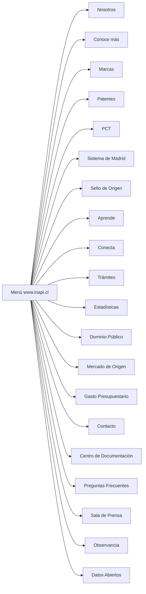
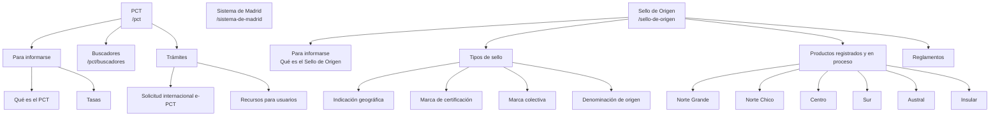
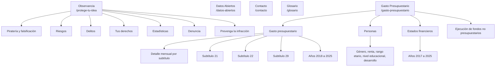

# Mapa de navegación — Sitio informativo original de INAPI

Origen: [www.inapi.cl](https://www.inapi.cl/), recorrido el 15 de octubre de 2026. El menú del inicio, el [mapa del sitio](https://www.inapi.cl/mapa-del-sitio) y las páginas de cada sección alimentan este mapa.

El sitio informativo vive en `www.inapi.cl`. Los trámites en línea, los buscadores de marcas y de patentes y ClaveÚnica son sitios aparte, enlazados desde aquí.

## 1. Inicio y chrome permanente

```mermaid
flowchart TB
  home["Inicio<br/>www.inapi.cl"]

  home --> header["Cabecera"]
  home --> hero["Bloque Buscar y tramitar"]
  home --> menu["Menú"]
  home --> pie["Pie"]

  header --> logo["Logo INAPI"]
  header --> texto["A+ / A- y contraste"]
  header --> redes["Facebook, X, LinkedIn, Instagram"]
  header --> buscador["Buscador del sitio"]
  header --> accesos["ACCESOS"]

  accesos --> tramitesExt["tramites.inapi.cl"]

  hero --> patHero["Patentes"]
  hero --> marHero["Marcas"]
  hero --> barra["Estadísticas · Notificaciones diarias · Preguntas frecuentes"]
  hero --> contactoFlotante["¿Quieres contactarnos?"]

  patHero --> busPat["Buscador de patentes<br/>buscadorpatentes.inapi.cl"]
  patHero --> comoPat["Cómo registrar una patente<br/>/patentes/para-informarse"]
  patHero --> solPat["Ingresa tu solicitud<br/>trámites, patente o modelo de utilidad"]

  marHero --> busMar["Buscador de marcas<br/>buscadormarcas.inapi.cl"]
  marHero --> comoMar["Cómo registrar una marca<br/>/marcas/para-informarse"]
  marHero --> solMar["Ingresa tu solicitud<br/>trámites, solicitud de marca"]

  barra --> est["/centro-de-documentacion/estadisticas"]
  barra --> notif["/notificaciones-diarias"]
  barra --> faqHome["/preguntas-frecuentes/propiedad-industrial"]

  pie --> donde["Dónde estamos"]
  pie --> conversemos["Conversemos: Contacto"]
  pie --> accesosPie["Accesos del pie"]

  accesosPie --> atajos["/atajos-del-teclado"]
  accesosPie --> visual["/descarga-de-visualizadores"]
  accesosPie --> glosario["/glosario"]
  accesosPie --> mapa["/mapa-del-sitio"]
  accesosPie --> uso["/uso-de-los-contenidos-de-este-sitio"]
  accesosPie --> a11y["/accesibilidad"]
  accesosPie --> priv["/politica-de-privacidad"]
```

En el panel **Buscar y tramitar** del menú también aparecen el usuario frecuente (`ion.inapi.cl`), el registro en ClaveÚnica y estos atajos:

| Grupo | Destino |
| --- | --- |
| Marcas | Buscar en base de datos, notificaciones diarias, solicitud y pago en línea, renovación en línea, presentación de escritos, clasificador de productos y servicios |
| Patentes | Buscar en base de datos, notificaciones diarias, solicitud y pago en línea, presentación de escritos |

## 2. Menú principal

En el inicio el menú lista estas entradas, en este orden. En las páginas interiores el mismo menú hamburguesa omite Mercado de Origen y cambia el orden: parte en Conoce más y deja Nosotros junto a Observancia.

La barra visible, sin abrir el menú, muestra Nosotros, Conoce más, Marcas, Patentes, PCT, Sistema de Madrid, Sello de Origen, Aprende, Conecta y Trámites.

## 3. Conoce más, Marcas, Patentes, PCT y Sello de Origen

```mermaid
flowchart TB
  conoce["Conoce más<br/>/propiedad-intelectual-e-industrial"]
  conoce --> piInfo["Para informarse"]
  piInfo --> pi1["Qué es la propiedad intelectual e industrial"]
  piInfo --> pi2["Conceptos fundamentales"]
  piInfo --> pi3["Derechos e instituciones que los administran"]
  piInfo --> pi4["Principales derechos de propiedad intelectual"]
  piInfo --> pi5["Importancia legal"]
  piInfo --> pi6["Tribunal de Propiedad Industrial"]
  piInfo --> pi7["Historia de la propiedad industrial"]

  marcas["Marcas<br/>/marcas"]
  marcas --> mInfo["Para informarse<br/>Qué es una marca"]
  marcas --> mTipo["Marcas según su tipo"]
  marcas --> mBus["Buscadores<br/>/marcas/buscadores"]
  marcas --> mTram["Trámites"]
  mTipo --> mCat["Categoría de la marca"]
  mTipo --> mTip["Tipo de marca"]
  mTipo --> mCob["Tipo de cobertura"]
  mBus --> mBus1["Buscar en base de datos"]
  mBus --> mBus2["Notificaciones diarias"]
  mBus --> mBus3["Otros buscadores"]
  mTram --> mT1["Solicitud nueva"]
  mTram --> mT2["Renovación"]
  mTram --> mT3["Anotación"]
  mTram --> mT4["Títulos y certificados"]
  mTram --> mT5["Recursos para usuarios"]

  patentes["Patentes<br/>/patentes"]
  patentes --> pInfo["Para informarse<br/>Qué es una patente"]
  patentes --> pTipo["Tipo de patentes"]
  patentes --> pBus["Buscadores<br/>/patentes/buscadores"]
  patentes --> pTram["Trámites"]
  pTipo --> p1["Patentes de invención"]
  pTipo --> p2["Modelo de utilidad"]
  pTipo --> p3["Diseños"]
  pTipo --> p4["Esquemas de trazado o topografías"]
  pTram --> pT1["Tramitación de patentes"]
  pTram --> pT2["Títulos y certificados"]
  pTram --> pT3["Recursos para usuarios"]
```

En la portada de Marcas, la categoría se abre en marca comercial, marca colectiva, marca de certificación y frase de propaganda.

## 4. Trámites, Aprende, Conecta, Dominio Público y Mercado de Origen

Las páginas de Trámites en `www.inapi.cl` explican el procedimiento. El botón Acceder sale hacia `tramites.inapi.cl`.

```mermaid
flowchart TB
  tramites["Trámites<br/>/tramites"]
  tramites --> td["Trámites digitales<br/>/tramites/tramites-digitales"]
  tramites --> tm["Marcas"]
  tramites --> tp["Patentes"]
  tramites --> tpct["PCT"]
  tramites --> tdif["Difusión de la propiedad industrial"]

  tm --> tm1["Solicitud nueva"]
  tm --> tm2["Renovación"]
  tm --> tm3["Anotación"]
  tm --> tm4["Títulos y certificados"]
  tm --> tm5["Recursos para usuarios"]

  tp --> tp1["Tramitación de patentes"]
  tp --> tp2["Títulos y certificados"]
  tp --> tp3["Recursos para usuarios"]

  tpct --> tpct1["Solicitud internacional e-PCT"]
  tpct --> tpct2["Recursos para usuarios"]

  tdif --> td1["Explorador"]
  tdif --> td2["Comunidad"]
  tdif --> td3["Aula"]

  aprende["Aprende<br/>/aprende-de-propiedad-industrial"]
  aprende --> ap1["Cursos y talleres en línea"]
  aprende --> ap2["Martes de propiedad industrial"]

  conecta["Conecta<br/>/conecta"]
  conecta --> c1["Política de uso"]
  conecta --> c2["Guía de transferencia"]
  conecta --> c3["Manual de usuario"]

  dominio["Dominio Público<br/>/dominio-publico"]
  dominio --> d1["Qué es el buscador de dominio público"]

  mercado["Mercado de Origen<br/>/mercado-de-origen"]
  mercado --> me1["Todos"]
  mercado --> me2["Hecho a mano"]
  mercado --> me3["Carne criolla"]
  mercado --> me4["Chile dulce"]
  mercado --> me5["Nuestro mar"]
  mercado --> me6["Fermentados"]
  mercado --> me7["Tierra generosa"]
```

## 5. Institucional, documentación y transparencia

```mermaid
flowchart TB
  nosotros["Nosotros<br/>/acerca-de"]
  nosotros --> nInapi["INAPI"]
  nosotros --> nInd["Indicadores"]
  nosotros --> nBal["Balances"]
  nosotros --> nCal["Compromisos de calidad"]
  nosotros --> nTra["Trabaje con nosotros"]
  nosotros --> nRse["INAPI socialmente responsable"]
  nInapi --> n1["Funciones"]
  nInapi --> n2["Objetivos"]
  nInapi --> n3["Director nacional"]
  nInapi --> n4["Organigrama"]

  cdoc["Centro de Documentación<br/>/centro-de-documentacion"]
  cdoc --> leg["Legislación"]
  cdoc --> dir["Directrices"]
  cdoc --> rep["Reportes y guías"]
  cdoc --> inf["Informes"]
  cdoc --> bgi["Balance de gestión integral"]
  cdoc --> estu["Estudios"]
  cdoc --> open["Open Data"]
  cdoc --> estad["Estadísticas"]
  leg --> circ["Circulares"]
  leg --> reso["Resoluciones"]
  dir --> dirM["Marcas"]
  dir --> dirP["Patentes"]

  estad --> eM["Marcas"]
  estad --> eP["Patentes"]
  estad --> eU["Modelo de utilidad"]
  estad --> eD["Diseños"]
  estad --> ePct["PCT"]
  eM --> eMb["Nivel básico"]
  eM --> eMe["Nivel experto"]
  eM --> eMg["Marcas según género"]

  faq["Preguntas frecuentes<br/>/preguntas-frecuentes"]
  faq --> f1["Propiedad industrial"]
  faq --> f2["Marcas"]
  faq --> f3["Patentes"]
  faq --> f4["PCT"]
  faq --> f5["Sello de Origen"]

  prensa["Sala de Prensa<br/>/sala-de-prensa"]
  prensa --> pr1["Noticias"]
  prensa --> pr2["Columnas"]
  pr1 --> pr3["Detalle de noticia"]
  pr1 --> pr4["Todas las noticias"]
```

